<p align="center">
  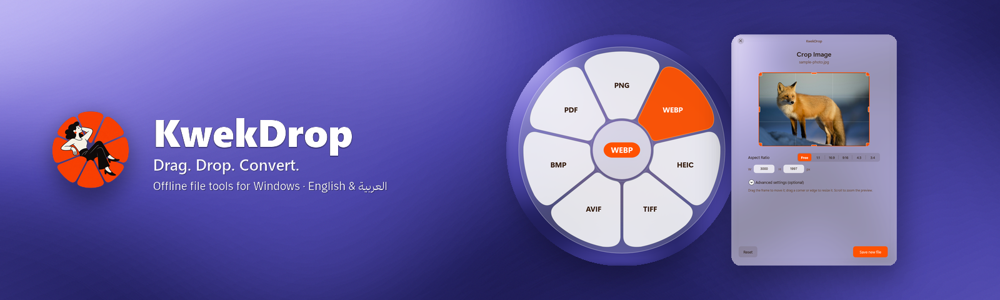
</p>

<p align="center">
  
  
  
  
  
</p>

**KwekDrop** is a lightweight Windows tray app that converts and edits files without opening any heavy program. Start dragging files, hold a key, pick a petal on the glass wheel and release. The result is saved next to the original, which is never touched. Everything runs on your PC: no uploads, no accounts, no analytics. Inspired by Tangerine for Mac.

<p align="center">
  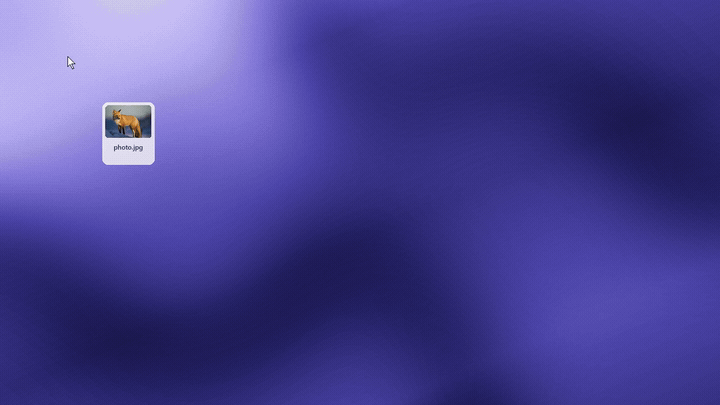
  <br />
  <a href="docs/media/demo.mp4">Watch the demo video (MP4)</a>
</p>

## Features

<table>
  <tr>
    <td width="33%">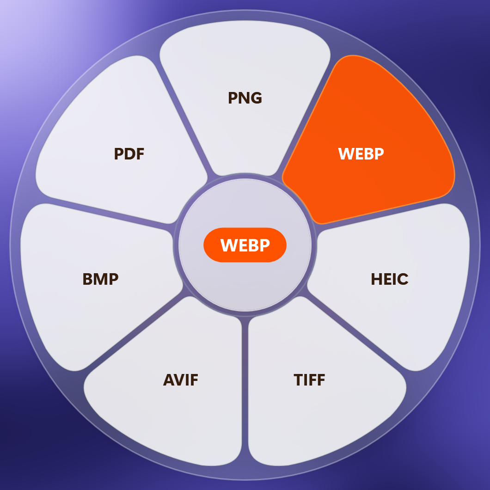<br /><b>Convert wheel</b><br />PNG, WebP, AVIF, HEIC, TIFF, PDF and more in one gesture.</td>
    <td width="33%">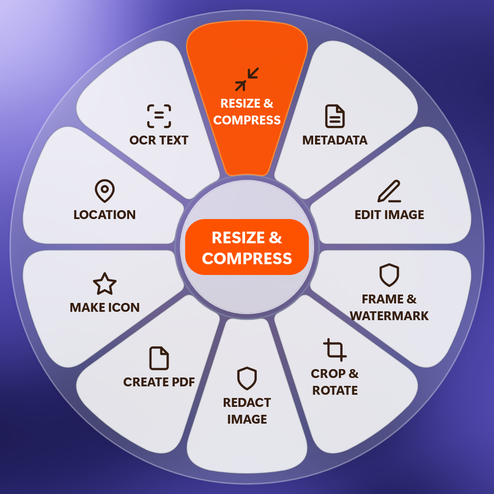<br /><b>Tools wheel</b><br />Resize, crop, redact, OCR, metadata, icons, PDF.</td>
    <td width="33%">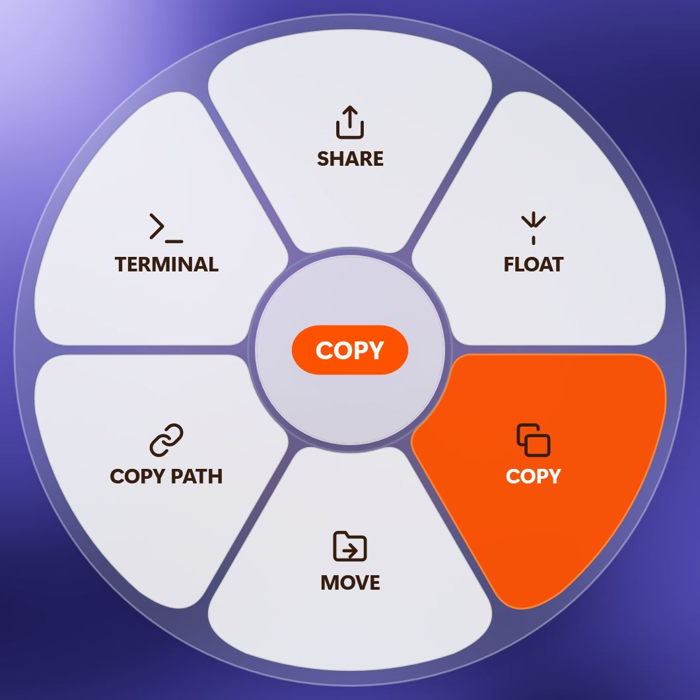<br /><b>Actions wheel</b><br />Share, float, copy, move, copy path, terminal.</td>
  </tr>
  <tr>
    <td>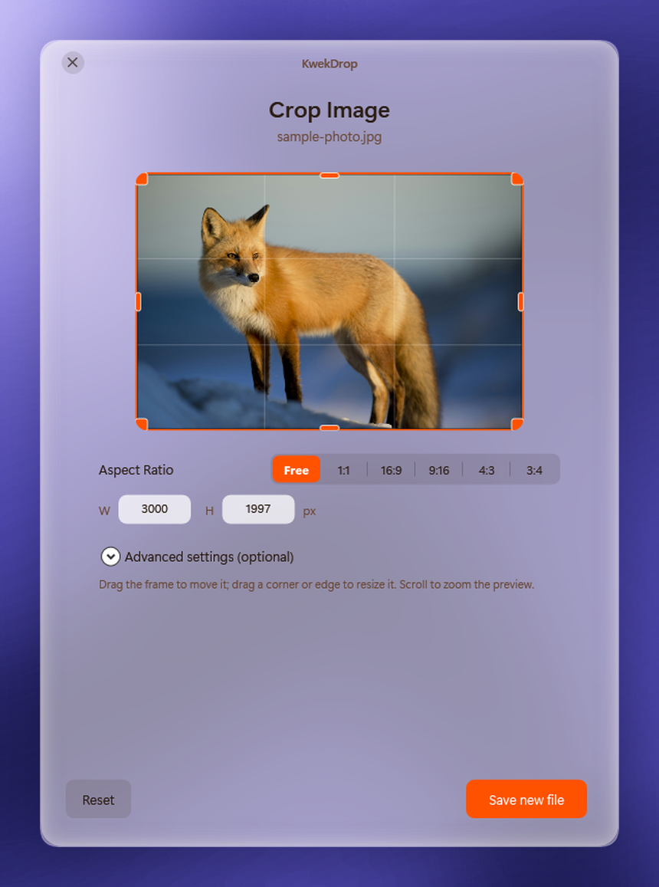<br /><b>Crop and rotate</b><br />Aspect presets, exact sizes, live preview.</td>
    <td>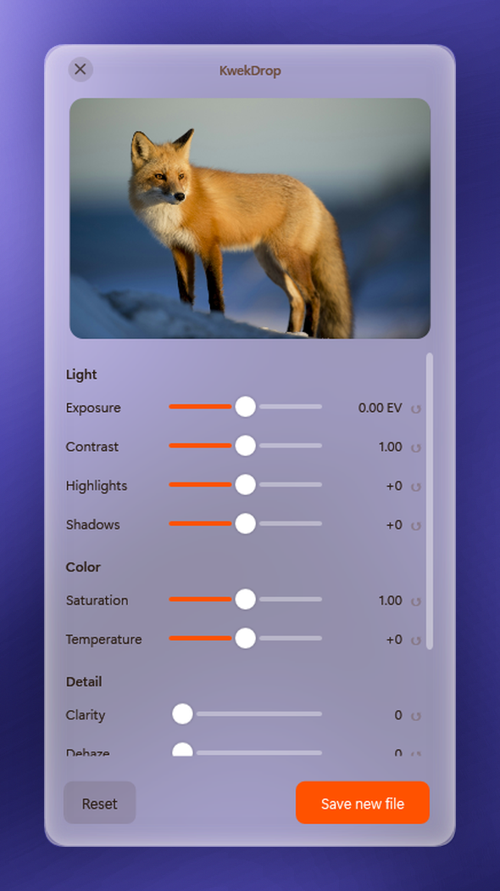<br /><b>Edit image</b><br />Brightness, colour and filters in a compact window.</td>
    <td>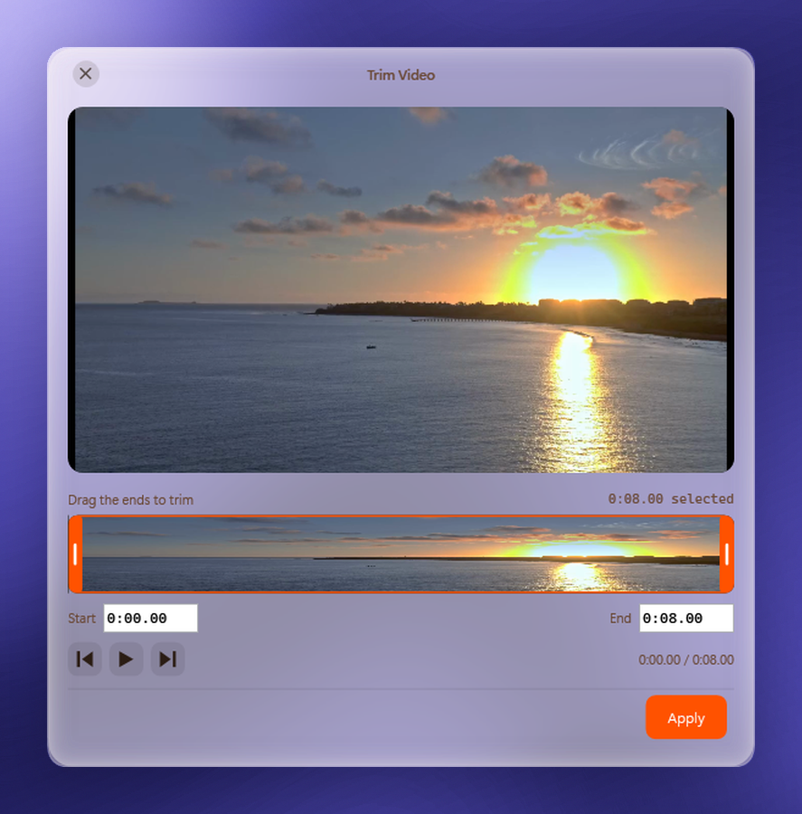<br /><b>Video and audio tools</b><br />Trim, speed, normalize, compress, bleep, GIF.</td>
  </tr>
  <tr>
    <td>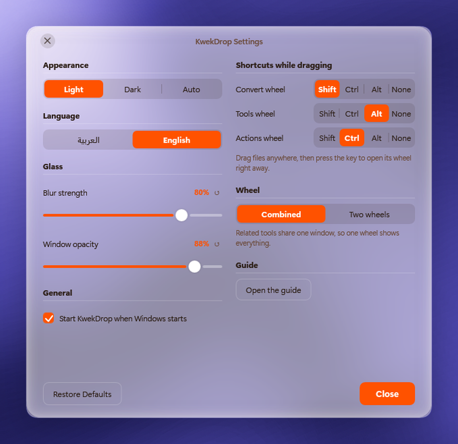<br /><b>Settings</b><br />Light, dark or auto; glass blur and opacity; wheel layout.</td>
    <td>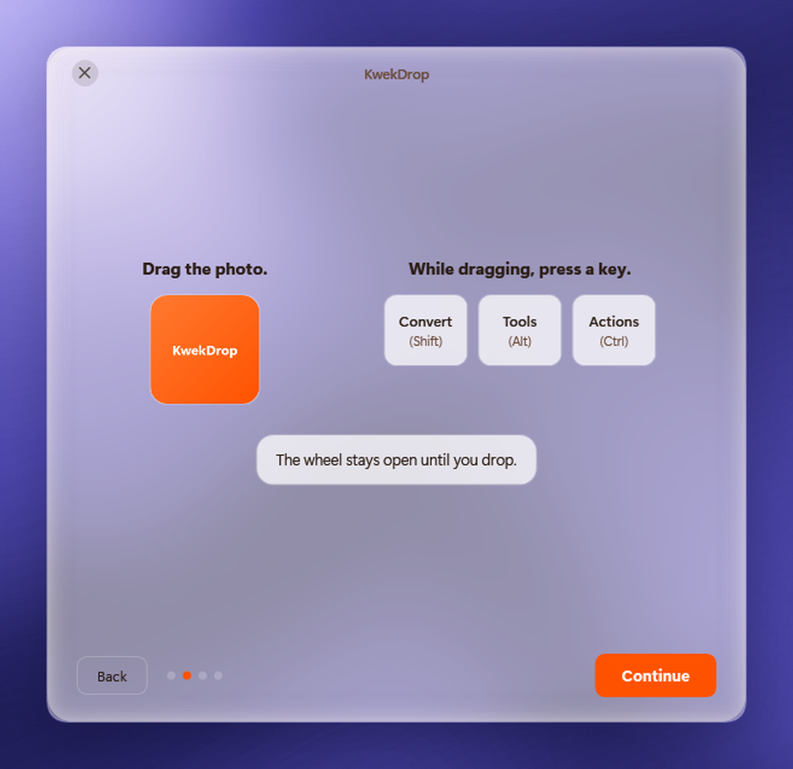<br /><b>Setup guide</b><br />Four friendly pages with a live drag try-out.</td>
    <td>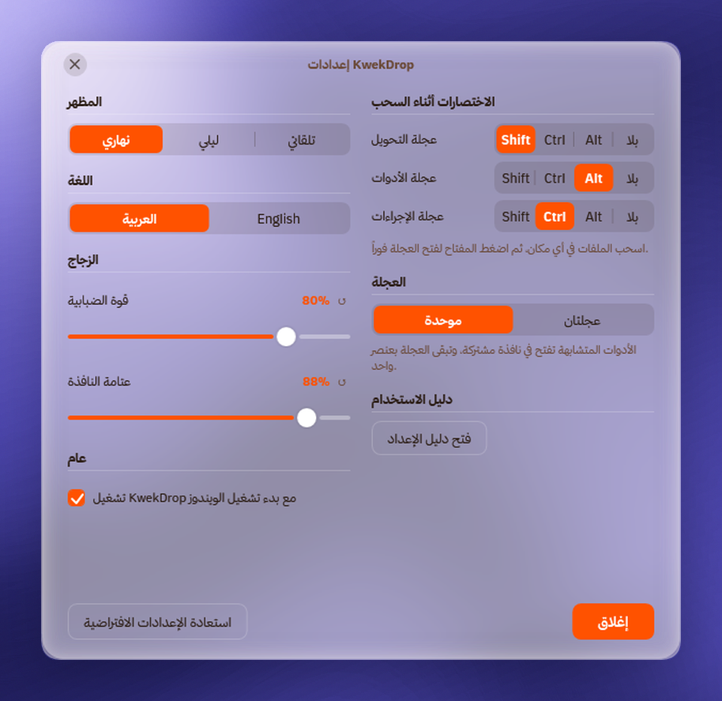<br /><b>Arabic and English</b><br />Right-to-left text, layout never mirrored.</td>
  </tr>
</table>

- **Real frosted glass.** The desktop shows through every window, blurred, with a thin white veil. Light theme by default, plus dark and match-Windows.
- **Three wheels, configurable keys.** While dragging: **Shift** opens Convert, **Alt** opens Tools, **Ctrl** opens Actions (each key can be changed or turned off in Settings). **F8** and **F9** are alternatives; **Esc** closes.
- **Sector click sound.** A soft mechanical tick plays only when you move between petals.
- **QR code maker.** Open it from the tray menu: text, link or Wi-Fi to a styled QR code with live preview, colours, shapes, an optional logo, and PNG or SVG export.
- **Bilingual.** English and Arabic (Modern Standard), with Thmanyah Sans for Arabic text.
- **Offline and private.** Images, video, audio, PDFs and archives are processed locally with bundled engines.
- **Original files stay safe.** Outputs are written next to the source with a new name.

## Supported formats and tools

| Category | Conversions and actions |
|---|---|
| **Images** | PNG, JPEG, WebP, AVIF, HEIC, TIFF, BMP, PDF, DOCX, SVG, ICO; crop and rotate, resize, watermark, EXIF scrubber, OCR |
| **Video** | MP4, MKV, WebM, MOV, GIF, MP3, WAV, AAC, FLAC; compress, trim, speed, split, frame snapshots, mute |
| **Audio** | MP3, WAV, FLAC, AAC, OGG; normalize, channels, trim, bleep, effects |
| **Documents** | PDF split and merge, redaction, image extraction, page numbers, Office export |
| **Archives** | ZIP, 7Z, TAR, GZ, RAR |

## Install

1. Download the `.msi` installer from the [latest release](https://github.com/ahmeddmakyy/KwekDrop/releases/latest).
2. Run it. It installs for the current user and adds a Desktop and a Start Menu shortcut.
3. KwekDrop starts in the system tray and a short guide walks you through the first drag.

To build from source instead:

```powershell
python tools/prepare-runtime.py   # downloads the bundled engines
./build.ps1                        # app folder in outputs/KwekDrop
python tools/wix/generate_components.py
wix build -arch x64 tools/wix/Product.wxs tools/wix/components.wxs -o outputs/KwekDrop.msi
```

Requires Windows 10 (1809+) or 11 x64, the .NET 8 SDK and WiX Toolset v4. The Thmanyah Sans font is not stored in this repository (see [fonts/README](src/KwekDrop/assets/fonts/README.md)); the app builds without it and falls back to Segoe UI.

## نبذة بالعربية

**كويك دروب** أداة ويندوز خفيفة لتحويل الملفات ومعالجتها دون فتح برامج ثقيلة: اسحب الملفات، اضغط **Shift** لعجلة التحويل أو **Alt** لعجلة الأدوات أو **Ctrl** لعجلة الإجراءات، ثم اختر الخيار وأفلت. ومن قائمة الأيقونة تجد أيضاً صانع رموز QR. تُحفظ النتيجة بجوار الملف الأصلي دون المساس به. كل المعالجة تتم على جهازك دون رفع أي ملف. الواجهة بالعربية والإنجليزية بزجاج مضبب حقيقي، والعربية بنصوص من اليمين إلى اليسار دون عكس التخطيط.

## License

KwekDrop is free software under the **GNU General Public License v3.0**, see [LICENSE](LICENSE).

## Third-party

KwekDrop bundles and uses these components, each under its own license: FFmpeg (GPL v3 build), 7-Zip, Python with PyMuPDF and other packages, and Thmanyah Sans (embedded in the compiled app as its license allows). Versions, licenses and sources are listed in [docs/dependencies.json](docs/dependencies.json) and in `THIRD-PARTY-NOTICES.txt` inside the app folder. The Thmanyah Sans font files are not covered by the GPL and are not part of this repository. The photos and video clips used in the screenshots and the demo are free stock media (Unsplash and Mixkit licenses).
