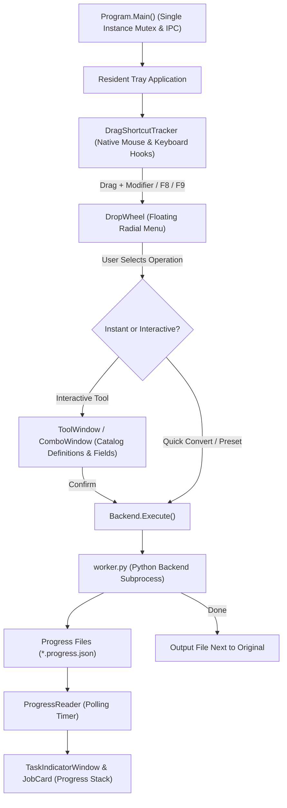

# KwekDrop Architecture

> **ملخص معماري:**  
> تطبيق KwekDrop هو أداة سطح مكتب خفيفة لنظام Windows تعمل من شريط المهام (System Tray) بدون نافذة رئيسية دائمة، وتعتمد على سحب الملفات مع مفاتيح الاختصار لإظهار عجلة الأدوات الدائرية.  
> ينقسم المشروع إلى واجهة مستخدم مبنية بـ WPF ومحرك معالجة خلفي بلغة Python مدمجة مع FFmpeg، مع تنظيم الكود المصدري في 7 مجلدات وظيفية تشترك جميعها في فضاء تسمية موحد (`KwekDrop`).  
> تتم المعالجة محلياً بالكامل بجوار الملفات الأصلية، مع دعم كامل للغتين الإنجليزية والعربية وأنماط العرض الفاتحة والداكنة وزجاج الأكريليك الدافئ.

---

## 1. Overview

KwekDrop is a lightweight Windows desktop file utility inspired by Tangerine. Key design characteristics:
- **System tray resident**: There is no permanent main application window. The app lives in the Windows notification area (system tray).
- **Gesture and shortcut driven**: Users drag files from File Explorer or the desktop while holding modifier keys (`Shift`, `Alt`, or `Ctrl`) or trigger hotkeys (`F8` / `F9`) to invoke a radial tool wheel (`DropWheel`) centered on the cursor.
- **Instant conversion & tools**: Releasing files over a wheel wedge executes quick conversions (e.g. image format conversion, video compression, PDF extraction) or opens focused tool dialogs.
- **In-place output**: Generated files are saved directly alongside the original inputs by default (or into a user-configured destination folder).
- **Hybrid runtime**: A high-performance C# WPF frontend orchestrates a local embedded Python backend bundled with Pillow and FFmpeg.

---

## 2. Source Map

All C# application sources reside under `src/KwekDrop/` and share a single flat namespace `namespace KwekDrop;`. Folders are purely organizational.

### Core (`src/KwekDrop/Core/`)
- `Backend.cs` — Launches backend Python processes (`worker.py`), serializes job requests, monitors execution, and cancels tasks.
- `ProgressReader.cs` — Polling mechanism that deserializes JSON progress files written by the backend worker to report live progress.
- `JobValidation.cs` — Validates job parameters, input file existence, and output constraints prior to execution.
- `Models.cs` — Core data models and records (`ConversionJob`, `JobProgress`, `BatchResult`, `FileResult`, `ToolOption`, `Preset`, etc.).
- `Catalog.cs` — Declarative catalog defining categories, tool operations, format options, parameters (`Field`), and wheel layouts.
- `Presets.cs` — Loads, saves, and applies user-defined custom tool and conversion presets.
- `Flows.cs` — Manages multi-step chained conversion pipelines (Flows) that execute operations sequentially.
- `WatchFolders.cs` — Monitors designated directories via `FileSystemWatcher` to trigger automated flows on new files.
- `OutputFolder.cs` — Computes target output paths (source directory, custom destination, desktop) and handles collision renaming.
- `ProcessTreePause.cs` — Uses native Win32 APIs to suspend and resume child process trees when pausing/resuming jobs.
- `TempSweep.cs` — Periodically cleans up temporary working directories, extracted archives, and orphaned scratch files.
- `ExplorerIntegration.cs` — Parses file paths passed from Explorer CLI invocations and routes single-instance IPC messages.
- `OfficeBridge.cs` — Interoperates with installed Microsoft Office applications via COM or CLI for document conversions.
- `Settings.cs` — Thread-safe persistence and retrieval of configuration options stored in `settings.json`.
- `CropMath.cs` — Pure mathematical calculations for aspect ratio enforcement, coordinate scaling, and crop rectangles.
- `RotationGeometry.cs` — Computes image rotation matrices, snap angles, and bounding box dimensions.
- `MediaSegment.cs` — Data model representing audio/video intervals and segment splits for playback and encoding.
- `TrimRange.cs` — Defines media in/out trim points, clip durations, and timeline selection boundaries.
- `RangePlayback.cs` — Range clamping, stop detection, and seek point selection for media playback.

### Platform (`src/KwekDrop/Platform/`)
- `Native.cs` — Win32 P/Invoke interop for low-level mouse/keyboard hooks, DWM window blur, and shell notifications.
- `StartupManager.cs` — Manages Windows run-at-startup configuration via registry keys or packaged startup tasks.
- `PackagedStartupProvider.cs` — Interfaces with WinRT `StartupTask` APIs for Windows Store / MSIX packaged environments.

### Wheel (`src/KwekDrop/Wheel/`)
- `FloatingWheel.cs` — The radial pie menu (`DropWheel`) UI rendered at the cursor position during drag or hotkey events.
- `DragShortcutTracker.cs` — Global mouse and keyboard tracker monitoring drag operations and modifier key combinations.
- `OpenMenu.cs` — Contextual menu popup for launching specific tools, presets, or destination overrides.
- `WheelOrderWindow.cs` — Configuration window allowing users to customize and reorder categories on the wheel.

### Windows (`src/KwekDrop/Windows/`)
- `ToolWindow.cs` — Interactive modal dialog for fine-tuning tool parameters. Employs the `MediaCompact` single-column layout for video and audio tools (with 44 px header, preview/timeline area, compact control rows, and 52 px footer), and traditional property grid layout for direct tools.
- `ComboWindow.cs` — Multi-step dialog combining multiple operations (e.g. crop + convert) into a single flow.
- `FlowWindow.cs` — Management window for creating, editing, and sequencing multi-step automated flows.
- `WatchWindow.cs` — Configuration window for setting up folder watch rules and automated actions.
- `SetupWindow.cs` — Four-page onboarding guide introducing drag gesture, shortcut keys, language and startup configuration.
- `SettingsWindow.cs` — Centralized settings dialog with appearance, language, glass blur/opacity, configurable shortcuts, and wheel layout.
- `TaskIndicatorWindow.cs` — Expandable, floating progress stack showing active and completed task cards on the desktop.
- `TrayMenu.cs` — System tray context menu handling settings, watch folders, flows, help, and exit.
- `TrayMenuPreview.cs` — Headless renderer and preview runner for inspecting tray menu states in automated tests.

### Controls (`src/KwekDrop/Controls/`)
- `CropFrame.cs` — Interactive WPF adorner and overlay with draggable handles for image cropping.
- `RotationDial.cs` — Rotary dial control allowing smooth angle adjustments with magnetic angle snaps.
- `MediaTimeline.cs` — Interactive media timeline scrubber with draggable in/out trim handles.
- `MediaTransport.cs` — Media playback transport bar (play/pause, step, seek, timecode) controlling WPF `MediaElement`.
- `SegmentedControl.cs` — Apple-style segmented pill selector for switching modes, formats, or aspect ratios.
- `ActivityIndicator.cs` — Smooth indeterminate circular spinner indicating active background work.
- `BusyLine.cs` — Subtle indeterminate horizontal line animation for lightweight loading states.
- `ContinuousFrame.cs` — Container element supporting smooth super-elliptical corner radii (Squircle).
- `JobCard.cs` — Individual task card displaying file progress, status, pause/resume, and cancel actions in `TaskIndicatorWindow`.
- `MetadataEditor.cs` — Key-value property grid control for viewing and editing EXIF and document metadata.

### Theme (`src/KwekDrop/Theme/`)
- `UiTheme.cs` — Central design system definitions: color tokens, brush resources, fonts, metrics, and theme switching.
- `WindowBlur.cs` — DWM backdrop blur integration (Acrylic, Mica, Accent) for semi-transparent windows.
- `AppIcon.cs` — Application icon loading and vector category glyph resolution helper.
- `SoundEffects.cs` — Plays low-latency notification sounds (e.g. `highlight.wav`) during wheel interactions and job completion.

### Localization (`src/KwekDrop/Localization/`)
- `Strings.cs` — Global localization coordinator providing `L.T(key)` and `L.F(key, args)` methods and language state.
- `StringsEn.cs` — English translation dictionary mapping canonical Chinese string keys to English.
- `StringsAr.cs` — Arabic translation dictionary mapping canonical Chinese string keys to Arabic.

### Root
- `Program.cs` — Entry point (`Main`), single-instance mutex and IPC, tray lifecycle, CLI argument dispatcher, and headless render test harnesses.

### Python Backend (`src/KwekDrop/backend/`)
- `worker.py` — Main CLI entry point for backend jobs; parses JSON parameters, dispatches operations, and writes progress files.
- `common.py` — Shared utilities for child processes, logging, category detection, progress reporting, and string lookup (`T()`).
- `archives.py` — Extraction and creation of compressed archives (`.zip`, `.tar.gz`, `.rar`, `.7z`) with path traversal guards.
- `documents.py` — Document rendering and transformation (PDF rasterization, text extraction, page splitting, OCR preparation).
- `images.py` — Image format transcoding, resizing, cropping, rotation, color adjustments, and EXIF orientation normalization via Pillow.
- `imagetools.py` — Advanced image features: watermarking, ICO file generation, and animated GIF creation.
- `location.py` — GPS EXIF extraction and formatting into readable coordinates or map references.
- `media.py` — Audio and video transcoding, bitrate compression, two-pass encoding, audio normalization, and channel filters via FFmpeg.
- `mediatools.py` — Media utilities: video-to-GIF conversion, clip trimming, subtitle embedding, audio extraction, and contact sheets.
- `ocr.py` — OCR text recognition and generation of searchable two-layer PDF documents.
- `office.py` — Microsoft Office document parsing and headless conversion routines for DOCX, XLSX, and PPTX formats.
- `pdftools.py` — PDF operations: merging, page splitting, password encryption/decryption, and watermark stamping.
- `translations.py` — English translation table for backend status messages and error descriptions.

### Assets (`src/KwekDrop/assets/`)
- `kwekdrop.ico`, `kwekdrop.png` — Main application icon assets in multiple resolutions.
- `fonts/` — Thmanyah Sans font family under the proprietary Thmanyah Font License ((c) 2026 thmanyah LLC). Font files are not redistributed in the source repository; embedded as a compiled resource in release builds, with fallback to Segoe UI in source checkouts.
- `icons/` — Core UI SVG icons (`airDrop.svg`, `copy.svg`, `copyPath.svg`).
- `sounds/` — Sound assets (`highlight.wav`) played during wheel navigation.
- `tangerine_icons/categories/` — Category vector glyphs for media types (`images.svg`, `video.svg`, `audio.svg`, `pdf.svg`, etc.).
- `tangerine_icons/tools/` — Action vector glyphs for tools (`cropImage.svg`, `compress.svg`, `splitPDF.svg`, etc.).

---

## 3. Architecture & Execution Flow

### 1. Initialization & Single Instance
- `Program.Main` attempts to acquire a named global Mutex (`Local\KwekDrop_20261003`).
- If another instance is running:
  - If files were passed via CLI, Explorer IPC passes them to the running instance via `ExplorerIntegration.Send()`.
  - Otherwise, it signals the named event `Local\KwekDrop_20261003_Show` to bring the existing instance into view.
- If first instance, `Resident` is initialized, establishing the tray icon, context menu (`TrayMenu`), and hotkey/drag watchers.

### 2. Drag & Hotkey Detection
- `DragShortcutTracker` registers low-level Windows hooks through `Native.cs`.
- When files are dragged while pressing `Shift`, `Ctrl`, or `Alt` (or when `F8`/`F9` is pressed), `FloatingWheel.cs` calculates the position and displays `DropWheel`.
- `DropWheel` queries `Catalog.cs` for options matching the dragged files' category.

### 3. Execution & Background Workers
- If the selected operation requires interactive user input (e.g. crop coordinates, video trim ranges, specific dimensions), a `ToolWindow` or `ComboWindow` is spawned, populated dynamically from `Catalog.cs` `Field` and `Operation` definitions.
- Once submitted, `Backend.Execute()` creates a job directory under `%LOCALAPPDATA%\KwekDrop\logs\`, serializes a `request.json` payload, and invokes `worker.py` via Python.
- During processing, `worker.py` writes incremental status into a `.progress.json` file.
- `ProgressReader.cs` polls this progress file on a UI timer, emitting live updates to `JobCard` controls hosted inside `TaskIndicatorWindow`.

---

## 4. Cross-Cutting Concerns

### Media Windows & MediaCompact Architecture
- **Single-Column Compact Shell (`MediaCompact`)**:
  - Replaces legacy two-column split ("Source preview" vs "Settings") with a narrow, content-fitted single column.
  - Sizing rules: `SizeToContent = SizeToContent.Height`, `MaxHeight = SystemParameters.WorkArea.Height * 0.92`, `ResizeMode = ResizeMode.NoResize`.
  - Grid row heights: Stage and Parameter rows use `GridLength.Auto` to guarantee visibility and prevent measure collapse inside content-sized parents.
  - Standard Chrome: 44 px header with centered title and top-left close button; 52 px footer with secondary action on the left and primary accent button (`UiTheme.Accent`) on the right.
- **Interactive Media Controls**:
  - `MediaTimeline`: Progressive 10-frame filmstrips extracted asynchronously via FFmpeg (with window-cancellation support) and high-resolution vector audio waveform rendering.
  - `MediaTransport`: Real-time playback transport with 33-40 ms position timer, single-frame stepping (`1/max(fps, 1)`), range clamping via `RangePlayback`, and play/pause hotkey support.
  - `TimeField`: Strict `m:ss.xx` formatted, focus-safe time boxes.
  - Directionality: Timelines, waveforms, and time boxes strictly preserve `FlowDirection.LeftToRight` across all languages (text-only RTL for Arabic labels).

### Theming & Glass (`UiTheme.cs`, `WindowBlur.cs`)
- **Themes**: Light (default crisp white and neutral slate), Warm Glass (soft beige and subtle blur), and Dark (deep charcoal and high contrast).
- **Desktop Blur & "Blur Strength"**:
  - `UiTheme.BlurAmount` (0–100) controls real Win32 DWM desktop blur via `SetWindowCompositionAttribute` (`ACCENT_ENABLE_BLURBEHIND`, accent state 3).
  - Setting `BlurAmount = 0` disables blur behind the window, applying an opaque readable veil (`0.94`).
  - Values `> 0` keep hardware-accelerated DWM blur and scale veil opacity dynamically via pure function `UiTheme.VeilAlpha(blur, glass) = Clamp(base - 0.22 * blur / 100, 0.12, 0.60)` where `base = Clamp(0.16 + 0.40 * glass / 100, 0.16, 0.60)`.
  - Visual updates re-apply live upon setting changes via `UiTheme.NotifyVisualsChanged`.
- **macOS Glass Parity for Floats**:
  - `FloatingWheel.cs`: Cool gray-cyan disc tint (`#40C0C9CD` at 25%), 72% white center pill veil (`#B8FFFFFF`), 70% specular rim (`#B3FFFFFF`), and cool slate drop shadow (`#263438` at 18%).
  - `JobCard.cs` / `TaskIndicatorWindow.cs`: 75% white veil (`#BFFFFFFF`), 1 px 70% specular inner rim, slate hairline (`#385D6666`), and cool drop shadow.

### Localization (`Strings.cs`, `StringsEn.cs`, `StringsAr.cs`)
- **Key-based translation**: Code references text via `L.T("ChineseKey")` or `L.F("ChineseKey", arg1, ...)`.
- **Languages**: Complete parity across English (`StringsEn.cs`) and Arabic (`StringsAr.cs`).
- **Typography**: Dynamically selects font families based on active language (Thmanyah Sans for Arabic, Segoe UI Variable for English; source checkouts without the Thmanyah font fall back to Segoe UI).
- **Layout**: Interfaces preserve logical orientation without mirroring to maintain consistent tool workflows.

### Settings & State (`Settings.cs`)
- Configuration is stored in `%LOCALAPPDATA%\KwekDrop\settings.json`.
- Thread-safe reads and writes with atomic JSON updates.
- Supports runtime override via `Settings.PathOverride` for isolated testing.
- Stores custom presets (`Presets.cs`), watch folder rules (`WatchFolders.cs`), and automated pipelines (`Flows.cs`).

---

## 5. Debug and Render Flags

`Program.cs` implements an extensive set of headless and interactive test flags for automated validation and documentation screenshot generation:

### Global Modifiers (combinable with any render flag)
- `--debug-theme <light|dark>` — Overrides active theme using an isolated temporary settings file.
- `--debug-lang <en|ar>` — Overrides active language using an isolated temporary settings file.
- `--debug-backdrop <image-path>` — Draws a blurred wallpaper image behind rendered windows.

### Render & Verification Flags
- `--debug-tool-render <operationId> <file> <out.png> [scene]` — Renders a `ToolWindow` headlessly to PNG; optional 5th parameter sets an initial state scene (e.g. `"crop=250,200,800,600;ratio=4:3"` or `"busy"`).
- `--debug-wheel-render <formats|tools|actions> <file> <highlightedId> <out.png> [theme] [lang]` — Renders the radial `DropWheel` stage directly to a high-resolution PNG.
- `--debug-crop-hit <file> <out.json>` — Instantiates `ToolWindow` with `cropImage` and calculates hit-test coordinates for all crop handles, exporting to JSON.
- `--debug-settings-render <out.png>` — Headlessly renders `SettingsWindow` to PNG (with backdrop support).
- `--debug-setup-render <page> <out.png>` — Headlessly renders `SetupWindow` page (1-4) to PNG.
- `--debug-indicator <prefix>` — Renders the `TaskIndicatorWindow` progress stack across multiple visual states (`<prefix>-single.png`, `<prefix>-expanded.png`, `<prefix>-collapsed.png`, `<prefix>-one-hidden.png`).
- `--debug-render-tray <out.png> [theme] [lang]` — Renders the system tray context menu headlessly to PNG.
- `--debug-tray-menu` — Runs an interactive standalone instance of the tray menu preview.
- `--debug-media-test <mediaFile> <out.json>` — Evaluates video/audio playback, pause holding, seeking, and frame rendering with `MediaTransport`.
- `--debug-tool <operationId> <file...>` — Interactively opens a `ToolWindow` or `ComboWindow` for manual UI testing.
- `--debug-window <wheel-order|watch|flows|setup|settings>` — Interactively opens individual secondary windows.
- `--capabilities <file> <out.json>` — Analyzes a file and dumps available conversions and tool capabilities to JSON.
- `--office-export <source> <target> <format>` — Invokes Office export via `OfficeBridge`.
- `--worker <request.json> <response.json>` — Directly runs the backend worker for a given request.
- `--convert <format> <files...>` — Runs a headless CLI conversion job without opening any UI.

---

## 6. Checks and Automated Tests

The codebase includes comprehensive automated test suites covering UI controls, parameter validation, progress lifecycles, and backend conversions:

### C# Check Projects
- `tests/ProgressChecks/` — Validates the full progress lifecycle, job suspension, temp folder sweeps, and complete English/Arabic UI string coverage. Application files are linked individually via `<Compile Include="../../src/KwekDrop/<Folder>/<File>.cs" />`.
- `tests/F9Checks/` — Tests F9 shortcut behaviors, tool parameter definitions, catalog consistency, and aspect ratio constraint mathematics.
- `tests/UiControlsChecks/` — Verifies UI controls, continuous squircle frame corner blending, rotation dial geometry, startup registration, and sound effects.

### Python Backend Tests (`tests/backend/`)
- All tests run using standard portable Python without extra external dependencies; test fixtures are generated under `tests/_generated/`.
- `test-i18n-ui.py` — Scans all application `.cs` files recursively (excluding `bin`/`obj`), ensuring all `L.T` / `L.F` keys are defined in both `StringsEn.cs` and `StringsAr.cs`, checking placeholder parity and absence of lingering Chinese text.
- `test-full-backend.py`, `test-archives.py`, `test-images.py`, `test-media.py`, `test-office.py`, `test-rotation-corners.py`, etc. — Thorough regression checks for file transformations and conversions.

---

## 7. Build and Packaging

- **Release Build (`build.ps1`)**:
  - Compiles and publishes the WPF project using .NET 8 (`win-x64`).
  - Copies Python backend scripts and embeds the portable Python + FFmpeg runtimes into `outputs/KwekDrop/`.
  - Generates `THIRD-PARTY-NOTICES.txt` via `tools/make-notices.py` from `docs/dependencies.json`.
  - Recursively mirrors application source files (excluding `bin`/`obj`) into `outputs/KwekDrop/source/`.
- **Runtime Preparation (`tools/prepare-runtime.py`)**:
  - Fetches and stages portable Python and FFmpeg binaries for offline redistribution.
- **Installer Creation (`tools/wix/`)**:
  - Compiles the Windows MSI installer (`Product.wxs`, `generate_components.py`) using WiX Toolset v4.
- **Continuous Integration (`.github/workflows/build.yml`)**:
  - GitHub Actions workflow that compiles the solution, executes the check suites, and publishes build artifacts.

---

## 8. Code & Architectural Conventions

1. **Single Namespace**: All C# classes belong to the root `namespace KwekDrop;`. Sub-namespaces are intentionally avoided to keep inter-file references seamless.
2. **Feature Folders**: Subdirectories (`Core/`, `Platform/`, `Wheel/`, `Windows/`, `Controls/`, `Theme/`, `Localization/`) represent structural domains. New files must be placed in the folder that best fits their responsibility.
3. **Check Project Synchrony**: The check projects under `tests/` explicitly link source files. When adding or moving a source file, update `<Compile Include="../../src/KwekDrop/<Folder>/<File>.cs" Link="<File>.cs" />` across the relevant `.csproj` files.
4. **Encoding & Line Endings**: Preserve exact file encodings and UTF-8 BOM presence across edits.
